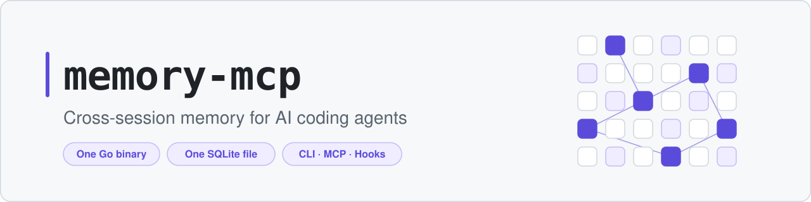
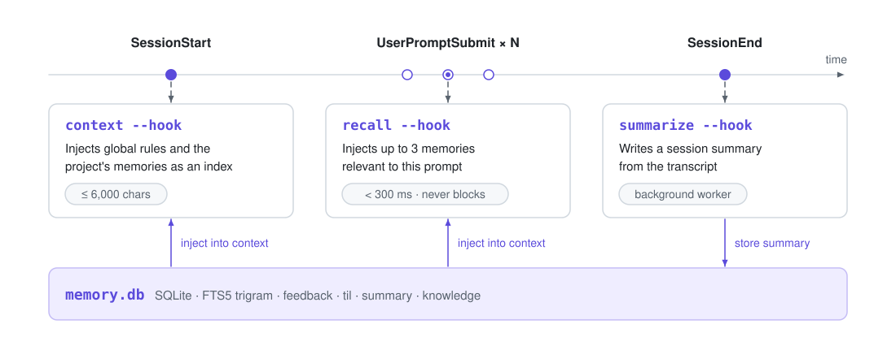
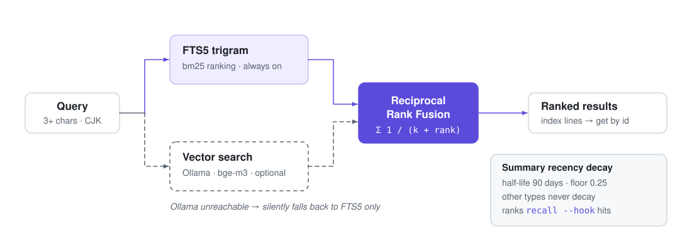

<div align="center">

<picture>
  <source media="(prefers-color-scheme: dark)" srcset="assets/banner-dark.svg">
  
</picture>

<p>
  <a href="https://github.com/ggwhite/memory-mcp/actions/workflows/ci.yml"></a>
  <a href="go.mod"></a>
  <a href="https://github.com/ggwhite/memory-mcp/releases"></a>
  <a href="LICENSE"></a>
</p>

**Cross-session persistent memory for AI coding agents — one Go binary, one SQLite file, usable from the CLI, as an MCP server, and from Claude Code hooks.**

[Install](#install) · [Quick start](#quick-start) · [MCP](#mcp) · [Hooks](#claude-code-hooks) · [CLI](#cli)

</div>

<br>


## Why

AI coding agents forget everything when a session ends. The bug you fixed yesterday, the convention the user corrected twice, the half-finished refactor — all gone, and the next session starts from zero.

memory-mcp gives agents a small, durable, searchable memory that is **agent-agnostic**: any agent that can run a shell command can use the CLI, any MCP client (Claude Code, Codex, ...) can use the MCP tools, and Claude Code hooks inject relevant memories automatically, without the agent having to ask.

## Features

<table>
<tr>
<td width="50%" valign="top">

**CJK-ready full-text search**<br>
SQLite FTS5 with the `trigram` tokenizer, so Chinese/Japanese/Korean text is searchable without a word segmenter (queries need 3+ characters).

</td>
<td width="50%" valign="top">

**Optional hybrid semantic search**<br>
When a local Ollama is reachable, `search` fuses FTS5 and vector results with Reciprocal Rank Fusion; when it is not, it silently falls back to FTS5 only.

</td>
</tr>
<tr>
<td valign="top">

**MCP server + full CLI**<br>
7 MCP tools over stdio or Streamable HTTP. The CLI covers store, search, list, get, timeline, update, delete, stats, export/import, reindex, compact, consolidate, observation, mental, and llm.

</td>
<td valign="top">

**Claude Code hooks**<br>
`SessionStart` injects global rules and project memories, every `UserPromptSubmit` injects up to 3 relevant memories in under 300 ms, and `SessionEnd` writes a session summary (then refreshes that project's mental models) in the background.

</td>
</tr>
<tr>
<td valign="top">

**Memory hygiene**<br>
`store --supersedes` replaces outdated rules in one transaction, `compact` rolls old summaries up by project and month, and stale summaries rank lower in `recall`.

</td>
<td valign="top">

**Token-efficient retrieval**<br>
Search and context return one index line per memory; full content is fetched on demand by id.

</td>
</tr>
<tr>
<td valign="top">

**Remote mode**<br>
Run one central REST server (`serve --http-api`) and point other machines at it with `--remote` / `MEMORY_MCP_REMOTE`.

</td>
<td valign="top">

**Secret hygiene**<br>
`<private>...</private>` blocks are stripped and common key formats are replaced with `[REDACTED]` before anything is written.

</td>
</tr>
<tr>
<td valign="top">

**Optional LLM**<br>
Summaries, `compact`, `consolidate` and mental models can use `claude -p`, the Anthropic API, or any OpenAI-compatible server (Ollama, LM Studio, OpenRouter). Paid providers are explicit opt-in, and hooks never call the LLM on the hot path.

</td>
<td valign="top">

**Consolidate &amp; observations**<br>
`consolidate` merges near-duplicate feedback into one canonical observation with its evidence ids; it works without an LLM and is undoable with `observation delete`.

</td>
</tr>
<tr>
<td valign="top">

**Mental models**<br>
Standing per-project questions (`mental add`) whose answers are rebuilt from your memories and shown in the SessionStart context.

</td>
<td valign="top">

**Search time filter**<br>
`search --since/--until` (and `since`/`until` on `memory_search`) limit results by creation time, with relative or absolute bounds.

</td>
</tr>
</table>

## Quick start

```bash
go install github.com/ggwhite/memory-mcp@latest

memory-mcp store -t til "SQLite trigram tokenizer enables CJK full-text search"
memory-mcp search "trigram"
claude mcp add memory -s user -- memory-mcp serve   # expose the 7 MCP tools to Claude Code
```

Then add the [Claude Code hooks](#claude-code-hooks) so memories are injected without the agent having to ask.

## Install

Requires Go 1.26.4 or newer (see `go.mod`).

```bash
go install github.com/ggwhite/memory-mcp@latest
```

Check the installed version with `memory-mcp --version`.

<details>
<summary><b>Prebuilt binaries</b> (macOS and Linux, amd64/arm64)</summary>

Download from the [Releases](https://github.com/ggwhite/memory-mcp/releases) page:

```bash
# pick the archive for your OS/arch, e.g. darwin_arm64
tar xzf memory-mcp_<version>_darwin_arm64.tar.gz
mv memory-mcp ~/.local/bin/   # or any directory on your PATH
```

The macOS binaries are not signed; if Gatekeeper blocks the binary, clear the quarantine flag:

```bash
xattr -d com.apple.quarantine ~/.local/bin/memory-mcp
```

</details>

<details>
<summary><b>From source</b></summary>

```bash
git clone https://github.com/ggwhite/memory-mcp.git
cd memory-mcp
make build          # produces bin/memory-mcp
```

</details>

## Architecture

<picture>
  <source media="(prefers-color-scheme: dark)" srcset="assets/architecture-dark.svg">
  
</picture>

memory-mcp is a single Go binary built on [`modernc.org/sqlite`](https://pkg.go.dev/modernc.org/sqlite) (pure Go, no CGO), so it cross-compiles cleanly and has no runtime dependencies. All data lives in one SQLite database in WAL mode, by default at `~/.local/share/memory-mcp/memory.db`.

The CLI, the MCP server, and the hooks are thin front-ends over the same `internal/db` package through a common `Store` interface; in remote mode that interface is backed by an HTTP client that talks to another memory-mcp instance running `serve --http-api`.

## MCP

### Claude Code

```bash
claude mcp add memory -s user -- memory-mcp serve
```

<details>
<summary><b>Equivalent JSON</b> (e.g. in <code>.mcp.json</code>)</summary>

```json
{
  "mcpServers": {
    "memory": { "command": "memory-mcp", "args": ["serve"] }
  }
}
```

</details>

<details>
<summary><b>Codex</b></summary>

`~/.codex/config.toml`:

```toml
[mcp_servers.memory]
command = "memory-mcp"
args = ["serve"]
```

</details>

<details>
<summary><b>Shared HTTP server</b></summary>

Instead of one stdio process per session, you can run one Streamable HTTP server and have every client connect to it:

```bash
memory-mcp serve --http 127.0.0.1:8766   # MCP endpoint: http://127.0.0.1:8766/mcp
```

</details>

### Tools

| Tool | Description |
|------|-------------|
| `memory_store` | Store a memory (`type`, `content`, optional `tags`, `project`, `supersedes` — ids of older memories this one replaces, deleted in the same transaction). |
| `memory_search` | Hybrid search; returns index lines by default (`compact=false` for full JSON). |
| `memory_get` | Fetch full content by comma-separated ids (max 20). |
| `memory_timeline` | Memories stored before/after a given id in the same project (default 3, max 10 each side). |
| `memory_list` | Recent memories, optionally filtered by `type` and `since` (e.g. `7d`). |
| `memory_delete` | Delete a memory by id. |
| `memory_context` | Bounded index of global feedback plus a project's feedback, summaries, and til/knowledge. |

### Memory types

| Type | Use for |
|------|---------|
| `feedback` | User preferences and corrections. **Requires a project**; use `global` for rules that apply everywhere. |
| `til` | Technical solutions and non-obvious fixes. |
| `summary` | Session / work summaries. |
| `knowledge` | Project or cross-project architectural knowledge. |

## Claude Code hooks

<picture>
  <source media="(prefers-color-scheme: dark)" srcset="assets/hooks-dark.svg">
  
</picture>

Add to `~/.claude/settings.json`:

```json
{
  "hooks": {
    "SessionStart": [{"matcher": "^(startup|resume|clear|compact)$", "hooks": [
      {"type": "command", "command": "memory-mcp context --hook", "timeout": 10}
    ]}],
    "UserPromptSubmit": [{"hooks": [
      {"type": "command", "command": "memory-mcp recall --hook", "timeout": 5}
    ]}],
    "SessionEnd": [{"hooks": [
      {"type": "command", "command": "memory-mcp summarize --hook", "timeout": 10}
    ]}]
  }
}
```

Each hook reads the Claude Code hook JSON from stdin (`session_id`, `cwd`, `prompt`, `transcript_path`) and never fails the hook: errors go to stderr or a log, and the exit code is 0.


- **`context --hook`** prints an index of: global feedback (`project=global`), the project's feedback, its 3 latest summaries, and other til/knowledge — capped at 6,000 characters (til/knowledge is trimmed first, feedback last). In a `personal-*` project or the `home` directory, only global feedback is injected. Memories with an empty project are never injected.
- **`recall --hook`** extracts query terms from the prompt (alphanumeric runs of 3+ chars and overlapping 3-character CJK windows), runs an FTS5 query, and prints at most 3 index lines that pass a conservative relevance threshold. Thresholds use the raw score; for ordering only, `summary` memories decay with age (see [Memory hygiene](#memory-hygiene)). Prompts shorter than 4 characters or starting with `/` are skipped, memories already injected in the same session are not repeated, and the whole command is bounded to 300 ms. It only queries the local DB (no embeddings) and does not support `--remote`.
- **`summarize --hook`** forks a background worker and returns immediately. The worker reads the transcript and asks the configured [LLM](#optional-llm) (by default `claude -p --model haiku`) to write a summary, stored as type `summary` with tag `auto-summary`. It skips sessions with fewer than 3 user turns or where a summary was already stored manually. If no LLM is configured it logs `skip: LLM not configured` and exits 0. Logs go to `summarize.log` next to the database.

<details>
<summary><b>Project derivation</b></summary>

The hooks derive the project name from the hook's `cwd`:

1. Longest **path-component** prefix match against `~/.config/memory-mcp/projects.json` (override the location with `MEMORY_MCP_PROJECTS`). The mapped value is lowercased.
2. Otherwise, if `cwd` is `$HOME`, the project is `home`.
3. Otherwise, the lowercased basename of `cwd`.

```json
{"prefixes": {"~/work/my-app": "my-app", "~/work/my-app-tools": "my-app"}}
```

Paths have `~` expanded, are cleaned, and have symlinks resolved; `~/work/my-app2` does **not** match `~/work/my-app`. A missing file falls back to the basename; an invalid file prints a warning to stderr and falls back too. The mapping is useful for monorepos or multi-repo workspaces whose subdirectories should share one project.

</details>

<details>
<summary><b>Optional: Obsidian note hints</b></summary>

When `cwd` is not in the prefix map (i.e. `home` or an unregistered directory), `recall --hook` also matches prompt terms against Markdown file and folder names in an Obsidian vault and appends up to 2 note paths. Set the vault with `MEMORY_MCP_OB`; if the directory does not exist, this step is skipped.

</details>

## Search

<picture>
  <source media="(prefers-color-scheme: dark)" srcset="assets/search-dark.svg">
  
</picture>

Every `search` (CLI and MCP) runs an FTS5 trigram query ranked by bm25. If a local [Ollama](https://ollama.com) is running, memories are embedded on write and `search` merges the FTS5 and vector rankings with Reciprocal Rank Fusion. If Ollama is unreachable, search falls back to FTS5 only.

```bash
ollama pull bge-m3      # default embedding model
memory-mcp reindex      # backfill embeddings for existing memories; safe to re-run
```

### Time filter: `--since` / `--until`

Both bounds filter on the creation time and apply to the FTS5 and vector branches alike. Each takes a relative age (`Nh`, `Nd`, `Nw`) or an absolute date (`YYYY-MM-DD`); `--until` with a date includes that whole day. A bad format is an error. The MCP `memory_search` tool takes the same values as `since` / `until`. Hook recall is not affected.

```bash
memory-mcp search --since 7d "deploy"                          # last 7 days
memory-mcp search --since 2026-10-01 --until 2026-10-31 "auth" # October, inclusive
```

## Memory hygiene

A memory store is only useful if it stays correct. Three mechanisms keep old or contradictory memories from crowding out the current ones.

### Replace outdated memories: `--supersedes`

`store --supersedes 12,34` (or `supersedes` on `memory_store`) stores a corrected rule or newer decision and deletes the old ones in one transaction; if any id is missing, nothing changes.


### Summary recency decay

When `recall --hook` orders its matches, `summary` memories decay with age (half-life 90 days, floor 0.25), so newer summaries rank ahead of stale ones while an old summary that is the only match is still returned. Thresholds use the raw score, and other memory types never decay.

### Compact old summaries: `compact`

`compact` rolls old summaries up into one summary per project and month with `claude -p --model haiku`. It is a dry run by default and writes a JSON backup before any change.


`compact` selects `summary` memories older than `--older-than` (default `60d`) and groups them by project and month; only groups of 2+ are merged. With `--apply` it first writes every row it will delete to `backups/compact-<YYYYMMDD-HHMMSS>.json` next to the database (same format as `export`), then for each group asks `claude -p --model haiku` for one merged summary (done / key decisions / still unfinished, keeping `#id` references). The merged memory is tagged `compacted,month:YYYY-MM`, keeps the newest original's `created`, and replaces the originals in one transaction. A group whose LLM call fails or returns nothing is skipped and left untouched. Local DB only.

## Optional LLM

The LLM is optional: storing, searching, listing and the hooks' `context` / `recall` work without one. It is used only by `summarize` (session summaries), `compact`, `consolidate` and `mental build`. Writes (`store`) never wait for an LLM, and `context --hook` / `recall --hook` never call it.

| Provider | Value | Notes |
|----------|-------|-------|
| Claude CLI | `claude-cli` | Runs `claude -p` with models `haiku` (cheap) and `sonnet` (synth). Uses your Claude subscription; no API key. |
| Anthropic API | `anthropic` | Direct HTTPS calls, defaults `claude-haiku-5-5` / `claude-sonnet-5-5`. Needs an API key. |
| OpenAI-compatible | `openai` | OpenAI, or any compatible server via `MEMORY_MCP_LLM_BASE_URL`: Ollama (`http://localhost:11434/v1`), LM Studio, OpenRouter. Both model variables are required. |

```bash
# Ollama, fully local
export MEMORY_MCP_LLM_PROVIDER=openai
export MEMORY_MCP_LLM_BASE_URL=http://localhost:11434/v1
export MEMORY_MCP_LLM_MODEL_CHEAP=qwen3:8b MEMORY_MCP_LLM_MODEL_SYNTH=qwen3:8b

# Anthropic API
export MEMORY_MCP_LLM_PROVIDER=anthropic MEMORY_MCP_LLM_API_KEY=sk-ant-...

memory-mcp llm status   # resolved provider, models, today's call budget; never prints the key
```

| Variable | Default | Description |
|----------|---------|-------------|
| `MEMORY_MCP_LLM_PROVIDER` | unset | `anthropic`, `openai`, `claude-cli`, or `off`. |
| `MEMORY_MCP_LLM_API_KEY` | — | API key. When empty, `ANTHROPIC_API_KEY` / `OPENAI_API_KEY` is used, **only** for the provider you named. |
| `MEMORY_MCP_LLM_BASE_URL` | `https://api.anthropic.com` / `https://api.openai.com/v1` | Override the API base. With `openai`, a custom base may omit the key (local servers). |
| `MEMORY_MCP_LLM_MODEL_CHEAP` | `claude-haiku-5-5` (anthropic), `haiku` (claude-cli) | Model for cheap tasks (classify, dedup). Required for `openai`. |
| `MEMORY_MCP_LLM_MODEL_SYNTH` | `claude-sonnet-5-5` (anthropic), `sonnet` (claude-cli) | Model for summaries and mental models. Required for `openai`. |
| `MEMORY_MCP_LLM_DAILY_CALLS` | `50` | Daily call budget; `0` means unlimited. Over budget, the call is skipped and logged. |
| `MEMORY_MCP_LLM_CLAUDE_KEEP_API_KEY` | unset | Set to `1` to keep `ANTHROPIC_API_KEY` / `ANTHROPIC_AUTH_TOKEN` in the `claude -p` child process. By default they are removed so `claude -p` uses your subscription instead of silently billing a key. |

**Resolution order:**

1. `MEMORY_MCP_LLM_PROVIDER` set to a provider: use it; a missing key (anthropic) or missing models (openai) is an error naming the variable.
2. `MEMORY_MCP_LLM_PROVIDER=off`: no LLM.
3. Unset: `claude-cli` if `claude` is on `PATH`, otherwise no LLM.

A paid provider is used only when it is named. An `ANTHROPIC_API_KEY` or `OPENAI_API_KEY` that merely exists in your environment never triggers billing. Prompts sent to the network providers go through the same secret redaction as writes.

Claude Max / Ultra subscribers get a monthly Console API credit that works with an `sk-ant-` API key, so the `anthropic` provider can use it. The OAuth token of a Claude plan must not be used by third-party tools; use `claude-cli` or an API key instead.

## Consolidate & observations

Agents tend to store the same correction many times. `consolidate` groups near-duplicate memories of one type (default `feedback`) inside a project and turns each group into a single **observation**: one canonical sentence plus the ids of the memories it came from (its evidence) and a `×N` proof count.

```bash
memory-mcp consolidate --project my-app            # plan only: print proposed observations
memory-mcp consolidate --all --apply               # backup, then write observations
memory-mcp consolidate --project my-app --type feedback --threshold 0.35 --cosine-threshold 0.85

memory-mcp observation list --project my-app
memory-mcp observation delete o3                   # accepts 3 or o3
```

Flags: `--project <p>` or `--all`, `--type` (default `feedback`), `--threshold` (character-trigram Jaccard, default `0.35`), `--cosine-threshold` (used when both memories have a vector from the same model, default `0.85`), `--max-cluster` (max members per cluster; larger similarity chains are split around seeds, default `20`), and `--apply`. The trigram default is conservative: short English feedback often needs `--threshold 0.25` to group, so preview a lower value before you `--apply` it. The default run only prints the plan and changes nothing; `--apply` first writes a JSON backup next to the database (same pattern as `compact`). Re-running refines an existing observation whose evidence overlaps instead of creating a duplicate, and skips groups whose evidence is unchanged. Local DB only (`--remote` is refused).

- **With an LLM** (cheap tier), the model decides which members state the same rule and writes the canonical sentence in their dominant language; the observation's `source` is `llm:<provider/model>`.
- **Without an LLM**, the canonical text is the newest member's content and `source` is `heuristic`; the output says `LLM: not configured ..., using heuristic`.

**In context:** `SessionStart` shows `### 全域 observations` and `### <project> observations` first, one line each: `- o3 ×2 <canonical> (ev: #1 #2)`. Memories that are evidence of an active observation are dropped from the raw feedback sections. With no observations the output is unchanged.

**Undo:** evidence memories are hidden, never deleted. `memory-mcp observation delete <id>` deactivates the observation and its evidence shows up in context again.

## Mental models

A mental model is a standing question about a project ("How do we deploy?", "What auth approach did we pick?"). `mental build` answers it from the project's memories with the LLM (synth tier) and stores the answer, so the SessionStart hook only reads a table and never calls the LLM.

```bash
memory-mcp mental add --project my-app "How do we deploy this service?"
memory-mcp mental list --project my-app
memory-mcp mental build --project my-app           # or --all; --force rebuilds even with no new memories
memory-mcp mental rm m3                            # accepts 3 or m3
```

The build input is the project's active observations, the top 20 memories matching the question (full-phrase search first, then one search per word, which helps natural-language and unspaced CJK questions), the 5 newest summaries, and, when those run thin, the newest `til` / `knowledge` notes, all deduplicated and capped at about 12,000 characters. The answer is at most 12 lines in the memories' language and cites sources as `#id` / `o<id>`. A project is skipped when it has no memory newer than the last build, unless `--force`. A failed or empty answer keeps the previous one.

**In context:** `SessionStart` adds a `### <project> mental models` section after the global observations and feedback and before the project's feedback; each model renders as `**Q:** question` followed by its answer lines, trimmed by the same budget as other sections. With no models the output is unchanged. When a `SessionEnd` summary is written and the project has mental models, the same background worker runs the incremental build; failures are only logged.

**No LLM:** `mental build` prints `LLM not configured (...), nothing built` and exits 0; `add`, `list` and `rm` still work. **Undo:** `mental rm <id>` deletes the model. Local DB only.

### Nightly run

Keep observations and mental models fresh with a scheduled job:

```cron
# every night at 03:30
30 3 * * * { memory-mcp consolidate --all --apply && memory-mcp mental build --all; } >> ~/.local/share/memory-mcp/nightly.log 2>&1
```

On macOS, put the same command in a launchd agent (`~/Library/LaunchAgents/com.example.memory-mcp-nightly.plist`) with `ProgramArguments` of `/bin/sh -c "{ memory-mcp consolidate --all --apply && memory-mcp mental build --all; } >> ~/.local/share/memory-mcp/nightly.log 2>&1"` (or set `StandardOutPath` / `StandardErrorPath` to the log instead of redirecting) and a `StartCalendarInterval` of `Hour` 3 / `Minute` 30; use the absolute path of the binary, since launchd does not load your shell `PATH`. Mind `MEMORY_MCP_LLM_DAILY_CALLS` if you have many projects.

## CLI

```bash
# Store
memory-mcp store -t til "SQLite trigram tokenizer enables CJK full-text search"
memory-mcp store -t feedback --project global "Prefer table-driven tests"
memory-mcp store -t knowledge --project my-app --tags auth,redis "Sessions live in Redis, TTL 24h"
memory-mcp store -t feedback --project global --supersedes 12,34 "Corrected rule"  # deletes #12 and #34

# Search (3+ characters; CJK works too)
memory-mcp search "trigram"
memory-mcp search "全文搜索"
memory-mcp search --compact --type til -n 10 "redis"
memory-mcp search --since 7d --until 2026-11-01 "deploy"   # time filter: Nh, Nd, Nw or YYYY-MM-DD

# Browse
memory-mcp list --type summary --since 7d -n 20
memory-mcp get 12 34
memory-mcp timeline 12 --before 3 --after 3
memory-mcp context --project my-app

# Manage
memory-mcp update 12 "corrected content"
memory-mcp delete 12
memory-mcp stats

# Compact old summaries (one per project + month; groups of 2+ only)
memory-mcp compact                                  # dry run: list groups, change nothing
memory-mcp compact --older-than 90d --project my-app
memory-mcp compact --apply                          # backup, merge with claude -p, delete originals

# Observations, mental models, LLM
memory-mcp consolidate --all --apply
memory-mcp observation list
memory-mcp mental build --all
memory-mcp llm status

# Backup
memory-mcp export > backup.json
memory-mcp import backup.json

# Servers
memory-mcp serve                          # MCP over stdio
memory-mcp serve --http 127.0.0.1:8766    # MCP over Streamable HTTP
memory-mcp serve --http-api 127.0.0.1:8766 # REST API for --remote clients
```

Global flags: `--json` (JSON output), `--db <path>`, `--remote <url>`.

Every memory carries a `source` provenance field (shown in `--json` output, kept by `export` / `import`): `user` for memories you or an agent stored (also the default for old exports), `llm:<provider/model>` for summaries written by the SessionEnd worker, and `compact` for `compact` roll-ups.

<details>
<summary><b>Remote mode</b></summary>

Run the REST API on the machine that owns the database, then point other machines at it (e.g. through an SSH tunnel):

```bash
# central host
memory-mcp serve --http-api 127.0.0.1:8766

# client
export MEMORY_MCP_REMOTE=http://127.0.0.1:8766
memory-mcp search "trigram"
```

Clients do not need Ollama; embeddings are computed on the central host. `reindex`, `compact`, and `recall --hook` always operate on the local database (`compact`, `consolidate`, `observation`, `mental` and `llm status` refuse `--remote`). The REST API has no authentication, so bind it to localhost or a private network.

</details>

<details>
<summary><b>Instructions for agents without MCP</b></summary>

For agents that only run shell commands, add something like this to `AGENTS.md` (or equivalent):

```markdown
# Cross-session memory
Store: memory-mcp store -t <feedback|til|summary|knowledge> [--tags t1,t2] [--project name] "content"
Recall: memory-mcp search "keyword"   |   memory-mcp list --since 7d
```

</details>

## Configuration

<details>
<summary><b>Flags and environment variables</b></summary>

| Setting | Default | Description |
|---------|---------|-------------|
| `--db` / `MEMORY_MCP_DB` | `~/.local/share/memory-mcp/memory.db` | Database path (the flag wins). |
| `--remote` / `MEMORY_MCP_REMOTE` | — | REST API URL of a central memory-mcp; overrides `--db`. |
| `MEMORY_MCP_OLLAMA_URL` | `http://localhost:11434` | Ollama base URL. |
| `MEMORY_MCP_EMBED_MODEL` | `bge-m3` | Embedding model. |
| `MEMORY_MCP_PROJECTS` | `~/.config/memory-mcp/projects.json` | Path-prefix → project mapping for hooks. |
| `MEMORY_MCP_OB` | `$HOME/ob` | Obsidian vault for `recall --hook` note hints (skipped if missing). |

</details>

## Development

```bash
make build   # go build -o bin/memory-mcp . (version from git describe)
make test    # go test ./...
make lint    # go vet ./...
```

The GIFs are recorded with [VHS](https://github.com/charmbracelet/vhs) against throwaway databases in `/tmp`: `vhs demo.tape`, `vhs assets/demo-recall.tape`, and so on, run from the repo root.

## Acknowledgements

Observations and mental models are inspired by [Hindsight](https://github.com/vectorize-io/hindsight) by Vectorize. memory-mcp keeps the ideas but not the cost model: it never calls an LLM on write or in a hook, and every LLM feature is optional.

## License

MIT — see [LICENSE](LICENSE).
